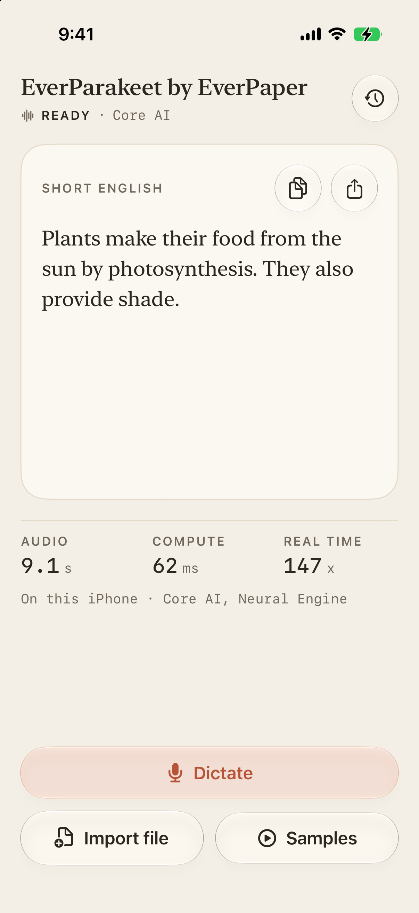
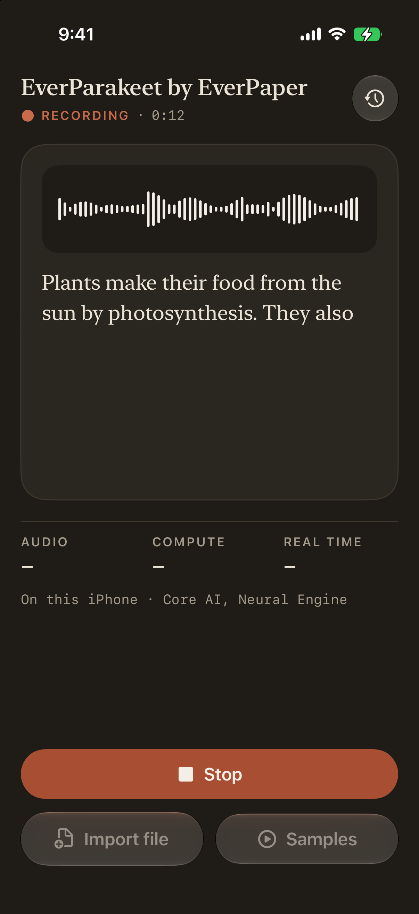
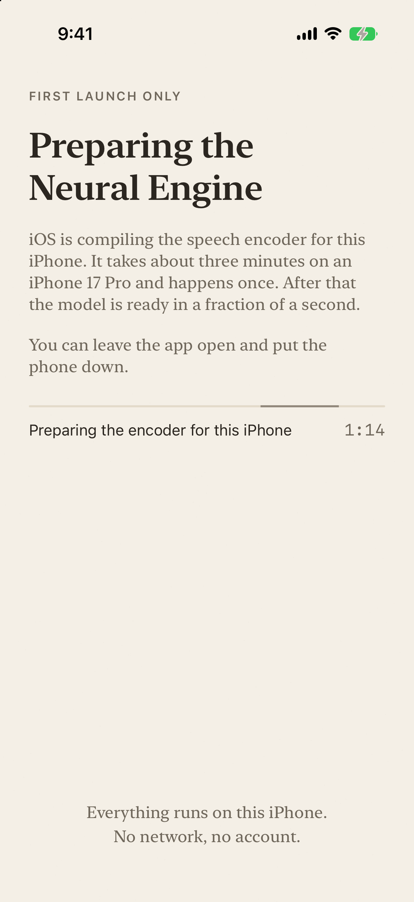

# EverParakeet by EverPaper

A small iPhone app that transcribes speech on the phone, with no network. It runs EverParakeet, which is NVIDIA
Parakeet TDT 0.6B v3 converted to run on the Neural Engine of Apple silicon. EverParakeet is
[Everpaper](https://everpaper.app)'s port of that model.

I made it to show the model on a real device and to give you a working example of the Swift package. It is a demo, not
a product.

<p>
  
  
  
</p>

The screenshots come from the iOS Simulator with a staged engine state (a debug-only `-preview` launch flag). They are
not recordings of the model running: the transcripts are what the Swift package produced for the bundled clips on a Mac,
and the speed shown (147x) is the figure measured on an iPhone 17 Pro, copied from the model card. The measurements are
in the section below.

## What it shows

- Live dictation from the microphone. The text appears as you talk. When you stop, a recording of up to 24 s shows the
  live text as the result at once, and a longer one gets one final pass over the whole recording.
- File import: any audio or video file the system can decode (wav, m4a, mp3, mp4, mov).
- Long-form: audio over 30 seconds is transcribed in overlapping 30 s windows and merged.
- Four bundled sample clips of real human speech: English, Italian, an Italian sentence followed by an English one,
  and a 60 s Italian clip that goes through the long-form path (see Samples below).
- The speed of every transcription (audio length, compute time, times real time) and which encoder ran.
- Core AI on the Neural Engine. The Swift package checks, after loading, that the encoder really is on the Neural
  Engine (Core AI can quietly cache a slower plan, see "When the Neural Engine plan goes wrong" below) and repairs it
  once if not. Core ML is used only if Core AI does not load, or is still not on the Neural Engine after the repair.
- A history of the last 25 transcripts, kept in a file on the phone.

## Requirements

- Xcode 27 (built here with 27.0, build 27A5228h).
- iOS 27 (the deployment target) on an iPhone with a Neural Engine.
- [XcodeGen](https://github.com/yonaskolb/XcodeGen) (`brew install xcodegen`). The Xcode project is generated from
  `project.yml`, it is not committed.
- An Apple developer account, to sign the app for your own iPhone.
- About 700 MB of free space for the model download, and about the same inside the app.

What was tested: the model and the Swift package ran on an iPhone 17 Pro with iOS 27.2 (the numbers below). This
version of the app was built for iOS with Xcode 27.0, and its screens and the live dictation loop were checked in the iOS
Simulator, which has no Core AI and runs the model through Core ML only (much slower than the phone).

## Set up

1. Download the model into `Model/`:

   ```
   scripts/fetch-model.sh
   ```

   It downloads EverParakeet Standard 1.1.1 from Hugging Face at a pinned revision (about 700 MB) and checks every file
   against the `CHECKSUMS.sha256` of that revision. It can be run again, it keeps files that are already correct.
   `scripts/fetch-model.sh --compact` fetches the smaller Compact 1.1 instead.
2. Choose your own identity. In `project.yml`, change `bundleIdPrefix` and `PRODUCT_BUNDLE_IDENTIFIER` from the
   placeholder `com.example.everparakeet` to an id you own. No signing team is set on purpose.
3. Generate the project: `xcodegen generate`.
4. Open `EverParakeetDemo.xcodeproj`, select your team under Signing & Capabilities, pick your iPhone, run.

The first launch on a phone takes a few minutes while iOS prepares the encoder for the Neural Engine (see below). The
app says so on screen and shows how long it has been.

To build without signing, for example to check that it compiles:

```
xcodebuild -project EverParakeetDemo.xcodeproj -scheme EverParakeet \
  -destination 'generic/platform=iOS' CODE_SIGNING_ALLOWED=NO build
```

Without the model in `Model/` the app builds and starts, and tells you to run the fetch script.

## Measured numbers

These are copied from the "On iPhone" section of the
[Standard model card](https://huggingface.co/EverPaper/everparakeet-tdt-0.6b-v3-coreai). They were measured on an
iPhone 17 Pro with iOS 27.2, with a test app built from the same Swift package, on a phone that was plugged in. Each
figure is a single run, and the phone's thermal state was fair during the speed and memory runs.

| Core AI encoder | |
|---|---|
| Speed, 140 clips (29 min of audio) | 147x real time |
| First launch, until ready (one-time encoder preparation) | 178 s, about 3 minutes |
| Second launch, until ready | 0.10 s |
| Peak memory (phys_footprint) | 862 MB |
| Transcripts compared with the same package on a Mac | identical on 140 of 140 clips |

With the Core ML encoder (the fallback) the same card gives 152x real time, 83 s for the first launch and 1,673 MB peak
memory. The card has the method and the rest of the table.

## When the Neural Engine plan goes wrong

Core AI prepares the encoder for the Neural Engine the first time it loads it and keeps the result. On one iPhone 17 Pro
(iOS 27.2) the connection to `com.apple.ANECompilerService` failed during that first preparation
(`NSCocoaErrorDomain` 4097). Core AI did not report a failure: it kept a plan that is not on the Neural Engine, and
every later launch of the app reused it. Each encoder call then took about 470 ms instead of a few milliseconds, and the
60 s sample ran at about 32x real time instead of about 160x. Core AI has no call that says which compute unit a plan
uses, so the app cannot read it, only measure it.

The Swift package (1.1.2) does the measuring and the repair; the app only says when a repair may run:

1. After loading, the package times the smallest encoder window on silence (best of three runs). Over 150 ms means the
   plan is not on the Neural Engine.
2. It then releases the encoder, deletes this model's Core AI cache entry, prepares it again and measures again, once.
   The app shows "Repairing the model preparation for this iPhone" while this runs (about three minutes on the
   iPhone 17 Pro) and keeps the screen awake.
3. A repair only starts while the app is in front and nobody is recording (`RepairGate`, set from `ContentView` and
   `AppModel`). Otherwise nothing is deleted, and the app waits for the foreground and loads again.
4. If the plan is still slow after the repair, the package says so (`EncoderHealth.notOnNeuralEngine`) and remembers it
   for this OS build, so the next launches do not repeat the three minutes. Only then does the app use Core ML, which
   gave 147x to 152x on this phone. The long "first launch" screen is switched off only after a healthy measurement
   (or after that Core ML decision).

What was measured, on the phone that had the bad plan, with a debug build compiled with optimisation and a single
launch each: the probe read 462 ms; the repair prepared the encoder again in 179 s; the probe then read 8.1 ms; the 60 s
sample ran at 158x, 169x and 166x real time right after, and at 169x, 175x and 177x on the next launch (which loaded the
encoder in 0.05 s and measured 8.1 ms). Not verified: other phones or iOS versions, what causes the original failure,
and whether deleting the cache entry repairs every device that ends up with a bad plan. Unit tests with a fake encoder
cover the decisions (probe, repair once, remember, foreground gate) in the package, `swift test`, no model needed.

## Samples

The four clips in `Samples/` are real recordings of volunteers reading sentences, from the test split of
[FLEURS](https://huggingface.co/datasets/google/fleurs) (Google, CC-BY-4.0): `en_us` for English, `it_it` for Italian.
The ids below are the audio file names in FLEURS (`<id>.wav`). The recordings are used as released (16 kHz, mono,
16-bit, no trimming, no filtering); the two longer clips are several recordings joined with 0.4 s of silence between
them.

| Clip | Length | FLEURS ids | Word error rate on a Mac |
|---|---|---|---|
| `english.wav` | 9.1 s | 16482413846901462656 | 0 % (13 words) |
| `italian.wav` | 10.7 s | 1713867707548638191 | 0 % (23 words) |
| `italian_then_english.wav` | 18.4 s | 175608475272644473 (Italian), then 2362130555763646360 (English) | 2.6 % (39 words) |
| `long_italian.wav` | 59.6 s | 1701941707910913361, 17132432282632650535, 16462150914726946412, 8953218902826726171, 14831071379897947070 | 0 % (107 words) |

"Italian, then English" is two separate sentences joined, not real code-switching inside one sentence. The long clip is
five recordings that differ in gender, pitch and recording conditions (FLEURS does not publish speaker ids).

The word error rates come from running the Standard 1.1.1 package (Core AI encoder) on a Mac and scoring against the
FLEURS reference text after the usual normalisation (lower case, punctuation removed). They are one run on four clips
that were picked because they transcribe cleanly, so they say the demo works, not how accurate the model is on your
audio; use your own voice and files to judge that. The Mac showed one thing worth knowing: after an Italian sentence the
model often dropped the English sentence that followed, for most of the English clips tried. The pair bundled here is one
where both come through.

## How it is built

- `Packages/EverParakeetKit` is the Swift package of the model repository (`swift/`, from version 1.1.2 on), copied
  unchanged. 1.1.2 is 1.1.1 plus the Core AI speed check and repair (see `CHANGELOG.md` in the package; the model files
  are those of 1.1.1). Earlier copies of the package cannot read the int8 decoder of Standard 1.1.1, so use this one.
- `App/` is the app: SwiftUI, one model and one decoding lane. `Engine.swift` loads the model and runs transcriptions,
  `Live.swift` is the live dictation loop, `Audio.swift` reads files and the microphone.
- `App/Style/` is a small self-contained style layer: colour and type tokens, a glass surface for tools, the pill
  buttons, the status line and the level meter. The text sits on an opaque page, the controls on glass. Only system
  fonts are used. Text follows Dynamic Type, both appearances are supported, and glass and motion have Reduce
  Transparency and Reduce Motion paths.
- `Samples/` has the four bundled clips, taken from the FLEURS corpus (see Samples below).
- Debug builds accept `-preview <scene>` to show a stubbed screen (used for the screenshots), `-autotest` to run the
  model on the samples and print the results, `-autorun <sample id>` to run one sample through the normal screen three
  times, `-coreml` to skip Core AI, and `-force-repair` to ignore a remembered failed repair. They print the encoder's
  status events to stdout.

## Models

- [EverParakeet Standard](https://huggingface.co/EverPaper/everparakeet-tdt-0.6b-v3-coreai): the model this demo
  downloads. Core AI and Core ML encoders, the Swift package, the numbers above.
- [EverParakeet Compact](https://huggingface.co/EverPaper/everparakeet-tdt-0.6b-v3-compact): smaller. Its model card
  reports it running on the iPhone 17 Pro with the Swift package from the Standard repository. Use
  `scripts/fetch-model.sh --compact`.
- [EverParakeet Mini](https://huggingface.co/EverPaper/everparakeet-tdt-0.6b-v3-mini): experimental, the smallest. This
  demo has no download option for it.

## License and credit

The code of this demo is CC-BY-4.0, the same as the published Swift package: see `LICENSE`. Three files in the package
are adapted from Apple's Core AI speech sample code and keep Apple's BSD 3-clause licence: see `NOTICE` and
`Packages/EverParakeetKit/THIRD_PARTY_NOTICES`.

The model weights are not in this repository. They are downloaded, and they are CC-BY-4.0, derived from
[NVIDIA Parakeet TDT 0.6B v3](https://huggingface.co/nvidia/parakeet-tdt-0.6b-v3). All credit for the architecture, the
tokenizer and the multilingual training goes to NVIDIA. This is not an official NVIDIA distribution and NVIDIA does not
endorse it.

The sample clips are from FLEURS (Google), CC-BY-4.0: <https://huggingface.co/datasets/google/fleurs>. They are
recordings of volunteers reading Wikipedia sentences, joined where noted. See Samples above for the exact utterances and
`NOTICE` for the attribution. Conneau et al., "FLEURS: Few-shot Learning Evaluation of Universal Representations of
Speech", 2022.
